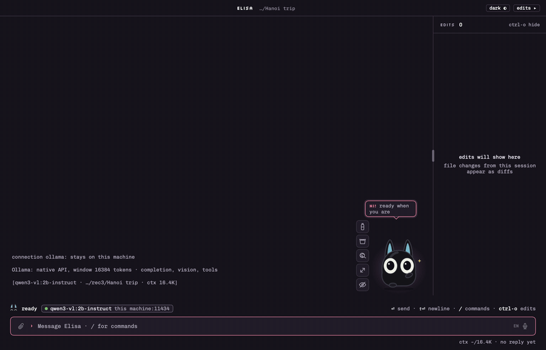

<p align="center">
  <picture>
    <source media="(prefers-color-scheme: dark)" srcset="designs/Logo/SVG%20(web)/elisa-lockup-horizontal-on-dark.svg">
    
  </picture>
</p>

<p align="center"><b>A personal assistant that lives on your Mac and runs on your models.</b></p>


Elisa is a chat assistant for your Mac. Talk to it like you would to any assistant: ask questions, think things through,
look something up on the web, read a PDF or a spreadsheet, describe an image. When you need it, Elisa can also work on
code with you. It runs on a model you choose, and with a local model nothing leaves your Mac.

It comes as a native macOS app and a terminal app, with Shade, a small companion who shows what Elisa is doing.

## What you can do with Elisa

- **Chat.** Everyday conversation, questions, explanations, writing help, brainstorming. Plain questions get plain
  answers, quickly.
- **Look things up.** Elisa searches the web and reads pages when a question needs fresh information.
- **Read documents and images.** PDFs, spreadsheets and pictures (pictures need a vision-capable model).
- **Work out problems step by step.** Built-in reasoning tools (think, steps, calc) help small models with harder
  questions, used only when a question needs them.
- **Get coding help.** One feature among the rest: Elisa can read a project, explain code, make changes with your
  approval, run its tests, and try snippets in an offline sandbox (Python, JavaScript, Rust, Go, Bash).

## Private and in your control

- **Your model, your choice.** Ollama, LM Studio, llama.cpp, MLX, or any OpenAI- or Anthropic-compatible API. Elisa
  never picks a model for you. The Model Scorecard shows measured results to help you choose.
- **Local first.** With a local model, your conversations stay on your Mac.
- **Nothing happens behind your back.** Reading is free. Writing files, running commands and anything outside the
  current folder ask first. Allow / ask / deny rules let you decide once.
- **Safe by default.** Secrets you paste are hidden from online models and from anything saved to disk, web and
  document content is treated as untrusted, and every action is recorded in a tamper-evident audit log.
- **Each conversation starts fresh.** A new chat follows what you ask in it. Continue an earlier one only when you
  choose to.

## Extend it

Everything Elisa can use plugs in through MCP. Built-in servers cover web search, documents, reasoning and the code
sandbox. Plugins bundle more MCP servers, slash commands and permission rules from a local folder, and run in an
offline container unless they need your Mac.

## Quick start

Requirements: macOS 14 or later, Rust and Swift toolchains. Colima is optional, for the code sandbox and container
plugins.

```sh
# macOS app (builds everything it needs)
app/ElisaApp/run.sh                      # choose a model, then start chatting
app/ElisaApp/run.sh --demo               # try the app without a model

# terminal app
cd elisa && cargo build --release        # binary: elisa/target/release/elisa
elisa/target/release/elisa               # chat in the terminal
```

<p align="center">
  
</p>
<p align="center"><sub>Elisa's coding feature, in the app's built-in demo session (scripted, no model needed).</sub></p>

## Repository

| Path | What |
|---|---|
| [`elisa/`](elisa/) | Elisa itself (Rust): chat, tools, MCP host and built-in servers, plugins, eval. Full documentation in [`elisa/README.md`](elisa/README.md). |
| [`app/ElisaApp/`](app/ElisaApp/) | The native macOS app (SwiftUI). |
| [`app/ElisaCompanion/`](app/ElisaCompanion/) | The small floating Shade companion window. |
| [`designs/`](designs/) | App icon and logo artwork. |

## License

Proprietary. Copyright (c) 2026 Johnny. All rights reserved. See [LICENSE](LICENSE) and
[THIRD_PARTY_NOTICES.md](THIRD_PARTY_NOTICES.md).
